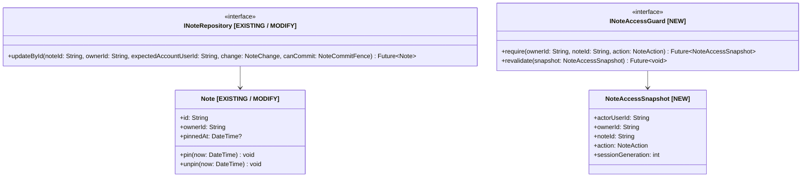

# Contract chung Module 02–03–04

Chốt ngày 2026-10-01 theo yêu cầu người dùng giao agent thống nhất thiết kế. Contract này ưu tiên hơn signatures/sort descriptions cũ của các report 02/03/04. Đây là target implementation đã chốt; source vẫn cần được implement và verify trong slice được giao.

## 1. Baseline và đính chính

Original freeze đối chiếu tại Final-here-do-not-merge-main@6ce2afe. Latest reviewed source cho implementation readiness là [16ee44b247d42119b4912ff38cf3f551fa0a8434](https://github.com/IvanTran0101/note_ai_app/commit/16ee44b247d42119b4912ff38cf3f551fa0a8434), đọc qua GitHub ngày2026-10-02; local checkout vẫn6ce2afe. Các target signatures ở đây giữ nguyên, không downgrade theo old source API.

Git diff từ `e24dd7fc9d1157e0df7f6f63a2d7f9c7de4b0363` tới 6ce2afe có 49 files: 47 Dart files (19 lib, 27 test, 1 tool) và 2 docs. Có thay đổi editor, Summary, Application/composition và tests. Nhận định trước “chỉ docs/không có code delta” sai và được đính chính.

`_agent_ops/tools/session_start.py` thiếu `.dart` trong CODE_SUFFIXES. Output của nó không chứng minh Dart source chưa đổi hoặc graph phủ Dart. Không thay tool trong lần chốt planning này; teammate dùng Git diff và exact source/HEAD. Local graph tại e24dd7f chỉ là navigation lead phù hợp, không completeness evidence cho Dart.

Ở6ce2afe chưa có atomic/pin APIs. Source16ee44b đã có pin, old-signature updateById, schema3/preferences và Application sortNotes, nhưng chưa đáp ứng named/fence/non-null-return target, Presentation comparator hoặc full-metadata Summary policy. PR-C0 migrate all callers/fakes trước M03/M04 integration. Canonical Module02 requirements đã đọc tại [02 — Core Note Management](https://app.notion.com/p/3dc25edc9a25819ea593e4b97fbd68dd?pvs=204); common file này là supplement integration cho teammate02.

## 2. Atomic mutation — signature duy nhất

Port/callback types thuộc Domain Notes, không import Application/Flutter/AWS vào Domain.

```dart
typedef NoteChange = Note Function(Note current);
typedef NoteCommitFence = bool Function();

abstract interface class INoteRepository {
  Future<Note> updateById({
    required String noteId,
    required String ownerId,
    required String expectedAccountUserId,
    required NoteChange change,
    required NoteCommitFence canCommit,
  });
}
```

Giữ existing find/save/delete khi migrate callers có kiểm soát. ownerId là canonical owner của resource `(ownerId, noteId)`; expectedAccountUserId là actor/account namespace capture trước await. Chúng có thể khác cho shared notes; không thay owner bằng actor hoặc coi body accountId là chứng cứ permission.

change nhận fresh mutable Note reconstituted trong transaction, sửa field của use case và trả **chính fresh instance đó**. Không trả captured stale aggregate. Return type Note tránh callback async trả Future bị dùng như synchronous transform. canCommit cũng synchronous, side-effect-free và không I/O.

```dart
change: (current) {
  current.rename(title, mutationTimeUtc);
  current.replaceContent(content, mutationTimeUtc);
  return current;
}
```

Hành vi bắt buộc:

1. Bind store từ captured expectedAccountUserId; cùng cached instance với Label repository/coordinator.
2. Trong ILocalSyncStore.update, đọc fresh Note theo owner/id; kiểm tra missing/deleted/conflicted state/fence; chạy change trên bản reconstituted độc lập.
3. Validate immutable identity/owner/createdAt, field invariants và association với fresh state; kiểm tra fence lại trước durable write.
4. Commit Note + outbox cùng transaction hoặc không ghi gì khi callback/validation/fence fail. Preserve fields không thuộc mutation, gồm pinnedAt/attachments/labelIds.
5. Trả committed Note; Application map sang NoteDto. No-op trả fresh Note, không đổi timestamp/outbox hay sync request thừa.

Fresh Label liveness/ownership và newly-added labelIds phải kiểm tra trong cùng transaction chứa catalog. Verified attachment binding vẫn được server kiểm tra tại association commit. Không HTTP/picker/upload/token refresh trong local transaction.

Fence false trước durable write → NoteMutationCancelledException (NEW Domain exception nhỏ, không nội dung/credentials); không partial state. Existing missing/ownership/storage error mapping được reuse khi có thể; không generic result framework. Callback ném lỗi thì abort transform.

Application fence so actor và CurrentUserSession.sessionGeneration với snapshot đã capture; khi policy có expiry, kiểm tra expiry. Known local revocation phải block và backend reauthorize ở server commit.

Logout khi native durable write đã bắt đầu không bảo đảm rollback một commit đã thành công. Write vẫn bind account cũ; controller discard late result, không update account mới. Phân biệt cancellation trước write với successful old-account write có response bị discard.

Text, pin/unpin, attachment link/unlink và label attach/detach đều dùng seam này. save(Note) không còn là đường replace stale aggregate cho các updates đó. New Note create/delete giữ lifecycle riêng và phải preserve metadata/cleanup rules.

ILabelRepository.updateById dùng cùng named-parameter/fence pattern, đổi noteId/Note thành labelId/Label. Label callback cũng synchronous trả chính fresh Label; không tạo store/queue riêng cùng ghi một native file.

## 3. Access guard — signature và safe snapshot

Port/snapshot thuộc Application; Infrastructure implements policy/remote/cache lookup. Domain không giữ JWT, unlock grant hoặc session object.

```dart
enum NoteAction { read, edit, organize, share, delete, summarize }

abstract interface class INoteAccessGuard {
  Future<NoteAccessSnapshot> require({
    required String ownerId,
    required String noteId,
    required NoteAction action,
  });

  Future<void> revalidate(NoteAccessSnapshot snapshot);
}
```

Snapshot immutable NEW có shape:

| Fields | Types | Nghĩa |
| --- | --- | --- |
| actorUserId, ownerId, noteId | String | Actor thật của current session và resource đã authorize |
| action | NoteAction | Action được kiểm tra; không đổi action khi reuse snapshot |
| sessionGeneration | int | Generation của process/session hiện tại |
| accessRevision, protectionRevision | int? | Policy versions đã kiểm tra; unknown không tự thành quyền |
| expiresAt | DateTime? | UTC earliest expiry khi policy/grant có thời hạn |

require capture actor/generation trước lookup, verify resource/action, recheck trước return. Snapshot là facts, không credentials hoặc unlock grant. Nó không thay server authorization. Missing shared/protected policy fail closed; owned/unprotected local operation có thể offline theo policy hợp lệ.

revalidate kiểm tra resource/action/actor/session và current permission/protection/expiry, recheck sau await. Success trả void; failure ném provider-neutral NoteAccessFailure (NEW Application type), codes unauthenticated/sessionChanged/notFound/forbidden/locked/expired. Không raw SDK exception, content/name/password/token trong UI error.

| Use case | Action |
| --- | --- |
| M02 mở Note; M03 mở/download attachment | read |
| M02 title/content; M03 upload/link/remove attachment | edit |
| M02 pin/unpin; M04 attach/detach label | organize |
| Manage sharing; delete Note | share / delete tương ứng |
| Local/cloud Summary | summarize; cloud còn cần consent riêng |

Owned baseline organize/share/delete là owner-only. Shared read/edit/summarize theo verified M05/M06 policy; actor không mượn unlock grant của owner. Label catalog CRUD kiểm tra own-label owner/session riêng, không bịa noteId để gọi guard.

Application require/revalidate trước side effects và trước local mutation/link. Async revalidation không chạy trong ILocalSyncStore.update: sync fence/fresh facts bảo vệ local boundary, server enforcement bảo vệ remote boundary.

## 4. Query và pin ordering dùng chung

Chốt pinnedAt: DateTime? UTC; null = unpinned, isPinned derive từ pinnedAt, không lưu mutable boolean thứ hai. Legacy default null. First pin ghi UTC time từ injected clock; repeat pin là no-op; unpin đặt null; pin sau unpin ghi thời điểm mới. Real mutation cập nhật updatedAt, no-op không cập nhật. Sorting dùng timestamp persisted/synced; không claim device clocks có global event ordering chính xác.

Một pure helper thuộc Presentation Notes. Target:

```dart
enum NoteSort { updated, created }

int compareNotes(NoteDto a, NoteDto b, {required NoteSort sort});

List<NoteDto> queryNotes(
  Iterable<NoteDto> readableNotes, {
  required String keyword,
  required Set<String> selectedLabelIds,
  required NoteSort sort,
});
```

NoteSort là shared successor của DashboardSort: giữ hai modes hiện tại, migrate callers/tests, không tạo comparators trùng nhau. Pipeline đã chốt:

1. Input chỉ authorized readable projections; controller xử lý unknown/tombstoned selected IDs theo catalog state.
2. Trim/lowercase keyword; title OR content substring. **ALL selected labels AND keyword**; empty keyword/selection không hạn chế theo phần đó. Không tự thêm accent folding/fuzzy search.
3. Trong matched set: pinned trước unpinned; pinnedAt descending cho pinned; selected updatedAt/createdAt descending cho unpinned.
4. Timestamps tie-break ownerId rồi noteId ascending. Cùng comparator cho list/grid/search/filter.
5. Catalog cold/error không tự prune selection. Khi tombstone được xác nhận, controller bỏ ID khỏi active selection. Pinned không vượt filter để hiện note không match.

Tests: old pinned/new unpinned, pin-time order/re-pin/no-op/unpin, created/updated modes, keyword+ALL labels/list/grid, same timestamp/same id khác owner, cold catalog selection.

## 5. NoteDto / SummaryRunGuard mapping

M02 sở hữu common projection mapping. NoteDto/equality/hash và mọi constructor/reconstitution/codec/ACK/conflict copy phải giữ cùng metadata shape khi implement pinnedAt, attachments, labelIds và access projection được duyệt.

Thêm một shared Application mapping từ LocalNoteState sang NoteDto (factory/helper ở Notes Application boundary). SummaryRunGuard dùng chính mapping này, không giữ manual constructor thiếu fields. Infra/UI không tự dựng projection tương đương nhưng bỏ metadata.

Giữ full saved-note snapshot validation và account/session/consent/conflict guards hiện tại. Metadata mutation có thể invalidate run theo conservative policy; không bỏ field khỏi equality hoặc weaken guard để che mismatch. Rename Label giữ ID/chỉ đổi catalog nên không tự đổi Note text/labelIds hoặc gửi label name vào AI.

Regression cases: saved pinned Note không false noteChanged; real pin change trong run invalidate theo policy; attachment/label round-trip đủ fields; same-account new-session late result bị discard; cùng persisted state cho UI/guard cùng DTO.

## 6. Diagram chuẩn cho reports

Mỗi node/participant ghi EXISTING/MODIFY/NEW; class methods có parameter và return type. Target diagrams không phải runtime PASS.



```mermaid
sequenceDiagram
  participant UI as Note editor / controls [EXISTING / MODIFY]
  participant APP as Note / Attachment / Label Application [MODIFY / NEW]
  participant GUARD as INoteAccessGuard [NEW]
  participant REPO as INoteRepository [EXISTING / MODIFY]
  participant STORE as ILocalSyncStore [EXISTING]
  UI->>APP: requested mutation
  APP->>GUARD: require(ownerId, noteId, action)
  GUARD-->>APP: NoteAccessSnapshot
  APP->>GUARD: revalidate(snapshot)
  APP->>REPO: updateById(named resource, actor, change, fence)
  REPO->>STORE: update(sync transform)
  STORE->>STORE: fresh state + fence + invariants
  alt valid context
    STORE-->>REPO: atomic Note + outbox commit
    REPO-->>APP: committed Note
    APP-->>UI: NoteDto in still-valid session
  else failure before write
    STORE-->>REPO: abort; no partial state
    REPO-->>APP: safe failure
    APP-->>UI: preserve draft / safe status
  end
```

## 7. Implementation ownership và gates còn lại

| Writer | Sở hữu | Consumers |
| --- | --- | --- |
| Shared core writer M02/M11, một writer lane | Atomic Note port/adapter, fence, pinnedAt, DTO mapping/query/comparator, coordinated metadata migration | M03/M04 dùng đúng contract, không tự tạo overload/fork schema |
| M03 teammate | Binary attempt/upload/read/cleanup và attachment metadata | Guard edit/read; shared fresh-Note mutation |
| M04 teammate | Label catalog/typed reconciliation/protocol/UI | Guard organize; shared query/pin ordering; coordinated codec/outbox |

Signatures, ALL filter, pinned order và Summary mapping giữ DEC-0055. Ngày2026-10-02 user yêu cầu complete implementation plan: M04 quyết định duplicate names allowed, 32IDs/Note, 64Unicode-code-points/name, owned/unprotected scope và schema4/wire2/bootstrap theo [protocol specification](sync_wire_v2_labels.md), PR order/ownership theo [current M04 plan](../organization/module_04_teammate_handoff.md). Đây là authority mới cho các choices M04 previously pending. M03 binary transport/file limits và full shared/protected policies vẫn scope riêng.

Target source compatibility/protocol trên chưa được implement qua task planning này. Teammate thực hiện ordered PRs, preserve dirty worktree và kiểm tra Git baseline. Run format/analyze/tests theo AGENTS. Planning agreement không thay source/runtime/cloud evidence; deployment/merge/commit/push vẫn cần authorization tương ứng.
